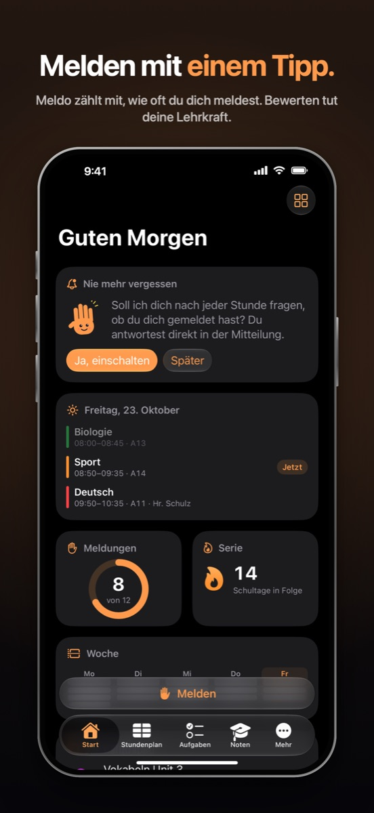
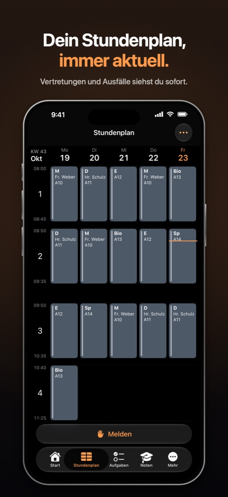
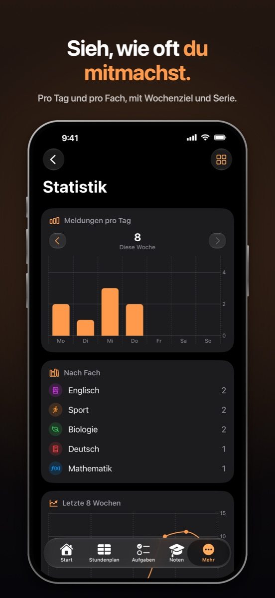

<p align="center">
  
</p>

<h1 align="center">Meldo for iPhone and iPad</h1>

<p align="center">
  <strong>The school planner that counts your hand-raises.</strong><br>
  Timetable, grades, homework and exams for students in Germany. No account, no ads, no tracking.
</p>

<p align="center">
  <a href="LICENSE"></a>
  
  
</p>

<p align="center">
  
  
  
</p>

> Meldo ist ein kostenloser Schulplaner für Schülerinnen und Schüler: Meldungen zählen, Stundenplan (optional aus WebUntis), Noten nach 1–6 oder 0–15 Punkten, Hausaufgaben und Klausuren. Alle Daten bleiben auf deinem Gerät.

## Features

- Count a hand-raise with one tap in the app, from a widget or from Control Center. If phones have to stay in the bag at your school, Meldo asks once after each lesson instead.
- Type in your timetable or import it from your school's WebUntis server, including substitutions, cancellations and room changes. The current lesson shows as a Live Activity / Live Update.
- See your average per subject on the German 1–6 or 0–15 point scale. Your school's weighting and rounding rules are settings, so they can match what your school uses.
- Keep track of homework and exams with reminders and an exam calendar. You can scan worksheets to PDF, import Microsoft Teams assignments if you want, and write excuse notes.
- Your data stays on the device, and Meldo has no server. If you turn on backup and sync, it goes to *your own* Google Drive and is encrypted on the device before it leaves (AES-256-GCM, PBKDF2-SHA256 with 600,000 rounds).
- German and English, light and dark mode.

## Download

The App Store release is coming soon. The website is [meldo.dev](https://meldo.dev), and the Android app is in [meldo-android](https://github.com/meldo-dev/meldo-android).

## How it's built

```
MeldePlanner/        The app target: entry point, navigation, the feature list (App/FeatureList.swift)
Packages/            Local Swift packages, one per module (below)
MeldeWidgets/        Widgets, Live Activity, Control Center button
Shared/              The Melden intent, compiled into the app and the widgets
MeldeCore/           Swift package wrapping the Rust core (generated bindings + XCFramework)
core/                meldo-core as a git submodule: Rust crates and the shared string catalog
MeldePlannerUITests/ UI walk-through and App Store screenshots
scripts/, tools/     Build helpers, icon and store-screenshot renderers
```

### Modules

```
App target            entry point, RootView, FeatureList.swift
 ├─ features          MeldoDashboard, MeldoTimetable, MeldoParticipation, MeldoTasks, MeldoGrades,
 │                    MeldoCalendar, MeldoStatistics, MeldoExams, MeldoHolidays, MeldoSubjects,
 │                    MeldoOnboarding, MeldoSettings
 ├─ integrations      MeldoUntis (with Abwesenheiten and Entschuldigung), MeldoTeams, MeldoDrive
 └─ core              MeldoUI     design system, shared rows and sheets, feature registry, Mehr
                      MeldoState  AppModel: data, mutate(), preferences, shared lookups, module hooks
                      MeldoKit    models (AppData), local store, sync merge, localization, engine glue
```

Dependencies only point down, and features never import each other. Each feature describes itself
once as a `MeldoFeature` (title, symbol, where it sits in the navigation, its screen, Start cards,
settings section, screens it offers to others, launch and refresh hooks). The tab bar, the iPad
sidebar, Mehr, Start and Einstellungen are built from the list in `App/FeatureList.swift`. Features
link to each other by route (`MeldoRoute`); a link to a feature that isn't built in doesn't show.

To leave a feature out, delete its line in `FeatureList.swift`, its `import` there and its package
from `project.yml`, then run `xcodegen generate`. `AppData` and the sync format don't change, so a build
without a feature still reads and syncs data written by one with it. Tests live in each package's
`Tests/` folder and run with the app scheme.

Grade math, timetable derivation, WebUntis parsing and statistics are written once in Rust in [meldo-core](https://github.com/meldo-dev/meldo-core), and the Android app uses the same code. [XcodeGen](https://github.com/yonaskolb/XcodeGen) generates the Xcode project from `project.yml`.

## Building (macOS with Xcode 26)

```bash
git clone --recurse-submodules https://github.com/meldo-dev/meldo-ios.git
```

```bash
cd meldo-ios && bash scripts/setup-mac.sh
```

The setup script checks for Xcode, Homebrew, XcodeGen and Rust, builds the Rust core for iOS, generates `MeldePlanner.xcodeproj` and opens it. To run on a device, set `MELDE_TEAM_ID` to your Apple team ID. When you pull changes to the core, run `git submodule update` and then `bash scripts/build-rust-ios.sh`.

### Google Drive and Teams (optional)

The OAuth client IDs are not in the repository. The app builds and runs without them; you just won't have Drive backup or the Teams import. To turn those on with your own Google Cloud and Azure apps, copy `Config/Secrets.example.xcconfig` to `Config/Secrets.xcconfig` and fill in the IDs.

## Contributing

Issues and pull requests are welcome. A few requests:

- Localize every user-facing string in German and English in `core/l10n/Localizable.xcstrings`. `python3 scripts/check_strings.py` checks the catalog.
- Run the unit tests for the code you changed.
- Don't commit secrets, keys or client IDs.

For security issues, see [SECURITY.md](SECURITY.md).

## Privacy

Meldo collects no data. The [privacy policy](https://meldo.dev/de/privacy) has the details ([English](https://meldo.dev/en/privacy)).

## Disclaimer

Meldo is an independent project and is not affiliated with, endorsed by or connected to Untis GmbH, Microsoft or Google. WebUntis is a trademark of Untis GmbH. Timetables and grades in Meldo can differ from your school's records, and your school's records always take precedence.

## License

[MIT](LICENSE) © 2026 Yavuz Selim Kolbasar
